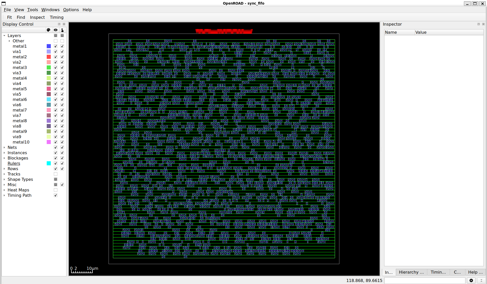
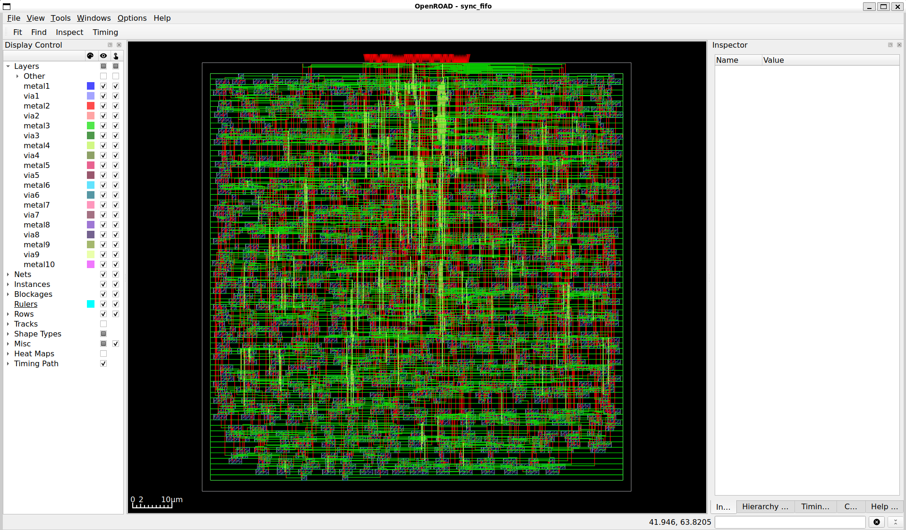
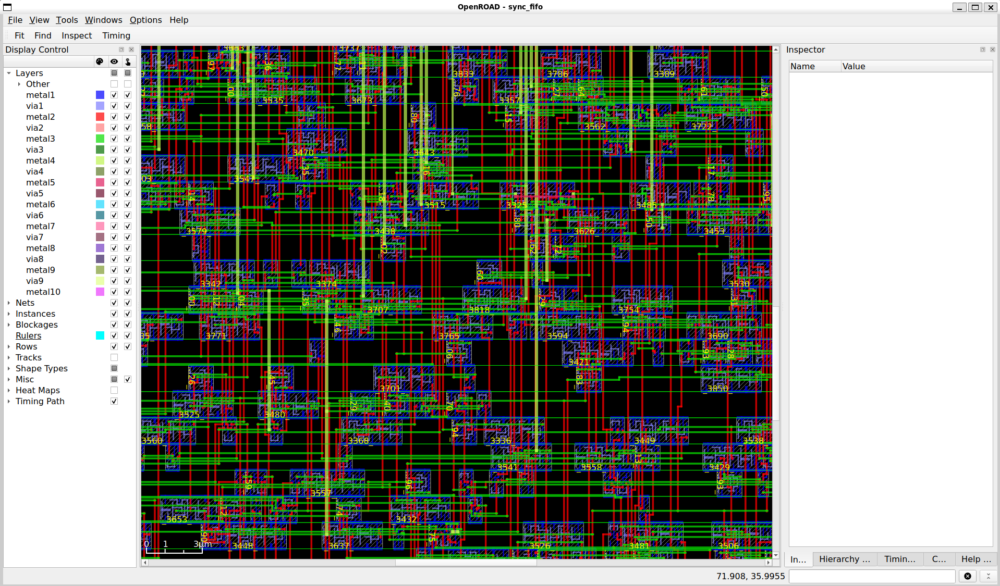

# Clock Tree Synthesis and Timing Optimization of a 32-bit Synchronous FIFO

## Project Overview

This project implements a 32-bit, 16-depth synchronous FIFO and takes it through a complete standard-cell physical-design flow, from RTL verification and synthesis to clock tree synthesis (CTS), timing repair, global routing and detailed routing.

The primary objective is to understand and implement the physical-design stages, analyze clock-tree behavior, repair hold violations and verify the final routed design using the Nangate45 standard-cell library.

## Design Specifications

| Parameter | Specification |
|---|---|
| Design | Synchronous FIFO |
| Data width | 32 bits |
| FIFO depth | 16 entries |
| Storage capacity | 512 bits |
| Clock period | 10 ns (100 MHz) |
| Standard-cell library | Nangate45 |
| Storage implementation | Register-based |
| SRAM macro | Not used |

## Physical Design Flow

1. RTL design using Verilog HDL.
2. Functional simulation and verification.
3. Generic synthesis using Yosys.
4. Technology mapping using Nangate45.
5. Floorplanning and IO pin placement.
6. Global placement and detailed placement.
7. Clock Tree Synthesis (CTS).
8. Hold violation repair.
9. Global routing.
10. Detailed routing.
11. Final physical verification and timing estimation.

## Key Results

| Metric | Result |
|---|---:|
| Generic synthesis cells | 1,123 |
| Technology-mapped cells | 1,936 |
| Technology-mapped cell area | 4,423.048 µm² |
| Mapped DFF_X1 cells | 557 |
| Clock buffers created during CTS | 81 |
| Hold buffers inserted | 3 |
| Global routing wire length | 46,859 µm |
| Detailed routing wire length | 32,714 µm |
| Detailed routing vias | 16,150 |
| Final design area | 4,561 µm² |
| Final utilization | 42% |
| Final detailed-route violations | 0 |
| Antenna net violations | 0 |
| Antenna pin violations | 0 |

### Timing Estimation

| Timing metric | Result |
|---|---:|
| Clock period | 10 ns |
| Setup slack | +5.650612 ns |
| Hold slack | +0.000058 ns |
| Setup clock skew | Approximately 0.11 ns |

**Timing methodology:** These final timing values use placement-based parasitic estimation. They are not based on detailed-route SPEF extraction or sign-off timing analysis.

## Functional Verification

The FIFO testbench verifies:

- Filling all 16 FIFO entries.
- Full flag assertion.
- Overflow write rejection.
- Reading all stored data in the correct order.
- Empty flag assertion.
- Underflow read rejection.
- Simultaneous read and write operation.

**Simulation result: ALL FIFO TESTS PASSED.**

## Clock Tree Synthesis and Timing Optimization

CTS was performed for 557 initial clock sinks. The generated clock tree contains 81 clock buffers and reaches a maximum reported tree level of 6.

After CTS, hold violations were repaired by inserting three hold buffers. The final placement-based timing estimate reports positive setup and hold slack.

## Physical Design Screenshots

### Pre-CTS Layout



### Final Detailed-Routed Layout



### Detailed Routing — Zoomed View



## Repository Structure

```text
.
├── rtl/
├── testbench/
├── constraints/
├── synthesis/
├── physical_design/
├── reports/
├── screenshots/
├── simulation/
├── docs/
├── README.md
└── .gitignore
```

## Tools and Technologies

- Verilog HDL
- Icarus Verilog
- Yosys
- OpenROAD
- Nangate45 standard-cell library
- Tcl
- Ubuntu Linux / WSL

## Reproducing the Flow

The project uses an external Nangate45 PDK. Its LEF and Liberty files must be installed separately, and the paths in the physical-design Tcl scripts must be updated for the local environment.

The main design source is `rtl/sync_fifo.v`, and the functional testbench is `testbench/sync_fifo_tb.v`.

Intermediate OpenROAD databases are provided selectively for inspection. The final physical-design database is `physical_design/fifo_final.odb`.

## Limitations

- Register-based FIFO implementation; no SRAM macro.
- No power analysis or power optimization result is claimed.
- No detailed-route SPEF extraction or sign-off timing result is claimed.
- No foundry sign-off or fabrication-ready GDSII is claimed.
- Results are based on the Nangate45 open standard-cell library and the stated design constraints.

## Conclusion

This project demonstrates a complete standard-cell physical-design implementation of a synchronous FIFO, including CTS, hold repair and detailed routing. It provides practical experience in RTL-to-physical-design implementation, clock-tree analysis, timing estimation and physical verification.
